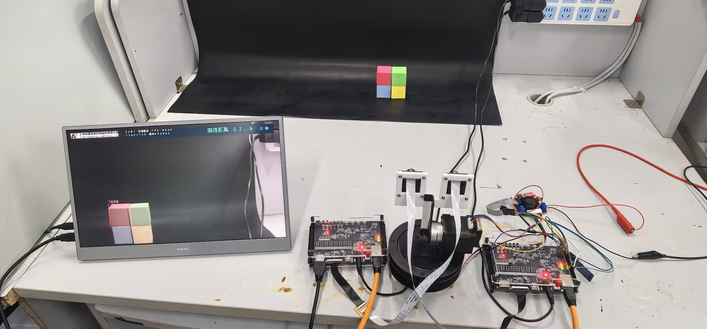

# PH1P35 Stereo Vision and 3D Interaction

[中文](README.md) · [Quick start](docs/guide/quickstart.md) · [Architecture](docs/guide/architecture.md)



A desktop vision research project built around two Anlogic PH1P35 boards and SC520CS cameras. This repository collects representative RTL, a versioned RTL and constraints archive, experimental RISC-V firmware, browser tools, sample point clouds, and engineering notes.

## Try it without hardware

Open `docs/index.html` in Chrome or Edge. Both computer-preprocessed sample clouds are embedded; no CDN or build step is required. The workbench supports rotation, PLY import/export, six-view snapshots, project ZIPs, and closed-base 2.5D relief STL export.

For a local HTTP preview:

```console
python -m http.server 8080 --bind 127.0.0.1
```

Visit `http://127.0.0.1:8080/docs/`. Camera and serial APIs depend on browser capabilities, a secure context, and explicit device selection.

## Scope and status

- Native stereo experiments use 1280×720 data, Census, and a **single horizontal aggregation path**. The available fixed-view hardware records do not establish dense surfaces or complete pose-control acceptance.
- AP2F/BP2F demonstrates FPGA display of **computer-preprocessed models**. The phone range control sends **manually entered values**, not automatic measurements.
- HDMI video is not XYZ data. CLOUD/1 requires an implementation on the data source; the AP2F display image does not provide a complete cloud-readback endpoint.
- Firmware samples include **unselected experimental services**. Their presence does not establish integration in a particular programmed image.
- RTL includes **curated excerpts and a versioned source archive**. The [archive](fpga/rtl-archive/README.md) preserves the supplied RTL, headers and constraints without merging same-named modules. Vendor `al_ip` directories, encrypted IP, tool installers and bitstreams are excluded; a complete board build is not supplied.

See the [version matrix](docs/guide/versions.md) and [validation notes](docs/guide/validation.md). Check [ATTRIBUTION.md](ATTRIBUTION.md) for provenance and licensing status before redistribution.

```console
python tools/verify_package.py
node tests/workbench.test.cjs
```
