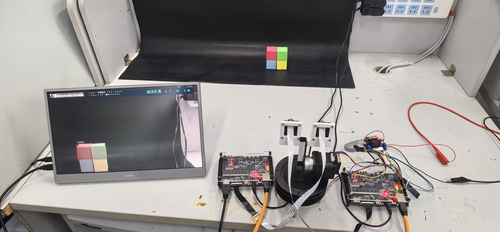
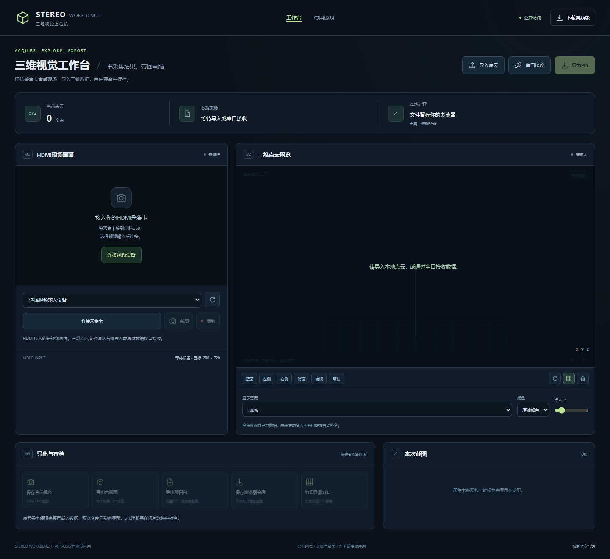

# PH1P35 双板视觉感知与三维交互

**双目采集 · 图像处理 · 原生深度实验 · 点云观察 · 蓝牙交互**

[English](README.en.md) · [快速体验](docs/guide/quickstart.md) · [架构说明](docs/guide/architecture.md) · [版本与状态](docs/guide/versions.md) · [实物图集](docs/guide/gallery.md)



基于两块安路PH1P35开发板与SC520CS摄像头的桌面视觉研究工程。项目涵盖单目处理、云台跟踪、双目深度、点云显示以及浏览器上位机。本仓库整理代表性RTL、多版本RTL与约束归档、硬核服务候选、可离线运行的网页工具和展示资料，方便理解各模块的分工并复用主机端工具。

## 可以看到什么

| 内容 | 本仓库提供的材料 |
| --- | --- |
| 单目视觉 | 灰度、二值化、边缘、颜色目标等原型照片及工程说明 |
| 原生720p实验 | Census与单水平路径聚合、原始深度导出、高清投影等代表性RTL；保留稀疏质量说明 |
| 蓝牙距离OSD | HC-05接线、BP2F二进制协议、50.0～75.0cm手动输入控制台 |
| 网页上位机 | 点云导入、旋转、PLY导出、六视图、项目包和2.5D浮雕STL |
| RISC-V硬核 | AE/AWB与目标服务候选C代码，标明尚未完整集成的接口 |

## 先体验网页

下载仓库后，用Chrome或Edge打开 **[docs/index.html](docs/index.html)**。页面不再内置点云，打开后等待导入自己的PLY等文件，或从兼容的数据源接收。无需安装Node、Python或访问CDN；载入后可旋转观察和完整导出。

也可在仓库根目录运行：

```console
python -m http.server 8080 --bind 127.0.0.1
```

然后访问 `http://127.0.0.1:8080/docs/`。摄像头和串口功能需要浏览器支持与用户选择设备，通常使用HTTPS或localhost；仅浏览点云无需连接硬件。发布GitHub Pages的方法见[上传说明](docs/guide/publishing.md)。



## 读代码的入口

| 目录 | 内容 |
| --- | --- |
| [fpga](fpga/README.md) | 原生深度、点云显示、蓝牙OSD的RTL摘选及多版本源码归档 |
| [firmware](firmware/README.md) | 内置RISC-V服务候选；保留原候选状态说明 |
| [host/workbench](host/workbench/README.md) | 无第三方JS运行依赖的上位机源代码与构建脚本 |
| [host/mobile-distance](host/mobile-distance/README.md) | 手机控制台与可选电脑SPP桥接 |
| [docs/guide](docs/guide/architecture.md) | 架构、版本、接线、协议与验证方法 |

## 功能状态怎么理解

- **保留原生双目实验，不附预存双帧演示。** AS95/NB94有1280×720深度数据与固定视角HDMI记录，但表面覆盖仍稀疏；已移除电脑预处理点云、预存模型上传与双帧切换模块。
- **距离控制台是手动输入。** 页面向OSD传递使用者输入的毫米值；0.1cm是调节和显示步进，不是自动测距精度。
- **HDMI视频与XYZ点云分别接收。** 浏览器的CLOUD/1接收协议需要数据源支持；本仓库未提供完整的板级CLOUD/1回读实现。
- **RTL按摘选与版本归档分别组织。** [rtl-archive](fpga/rtl-archive/README.md)保留了各版本中的RTL、头文件及现有约束，未合并同名模块。本仓库没有复制厂商`al_ip`目录、加密IP、安装包或参考位流，仍不是克隆后直接综合烧录的完整板级工程。
- **设计海报与范文另有定位。** 海报中的720p目标架构及理想完成态范文不作为当前实测性能证明。具体阶段以[版本表](docs/guide/versions.md)和[验证说明](docs/guide/validation.md)为准。

## 硬件概览

两块PH1P35开发板、双SC520CS摄像头、二维云台及驱动、HC-05、显示器和可选HDMI采集卡。蓝牙接线为B板M1→模块RXD、L4←模块TXD，双方共地，物理UART设置需与固件一致。详见[硬件连接](hardware/README.md)。

## 验证与开发

```console
python tools/verify_package.py
node tests/workbench.test.cjs
node tests/workbench-app.test.cjs
python host/workbench/build.py
```

以上检查文件、链接、PLY、校验与网页构建，不启动FPGA综合，不连接板卡，也不打开串口。电脑桥接程序只有在页面明确选择端口并点击连接后才打开串口。

## 资料与署名

本仓库保留来源和模块边界，未替作者选择MIT等统一开放许可证。照片、代码与资料的授权范围见[来源与许可说明](ATTRIBUTION.md)。论文与平台资料提供书目信息或官方链接，不复制别人完整报告及厂商工具。完整报告和A3海报适合放入GitHub Release，见随交付包提供的发布说明。
