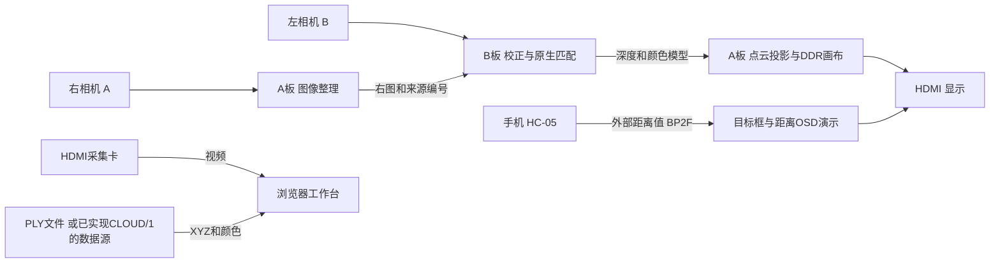

# 架构与数据来源

## 原生视觉与外部距离OSD

原生双目与外部距离OSD是不同的数据来源，不把一条链路的通过状态转移到另一条。电脑预处理点云和FPGA预存双帧演示已移除，网页仅显示用户导入、主动恢复或从兼容数据源接收的点云。

## 原生双目与投影

归档NB94模块使用5×5 Census与单条水平路径聚合；源码头部明确说明互反检查基于forward/reverse WTA，不是独立反向多路径SGM。每个1280×720网格位置都产生记录，质量不足或边界越界时无效，分辨率与有效点比例分别报告。

AS95的`hd_cloud_projector`将模型投影到1280×720画布，使用固定点坐标、观察参数快照及完整画布发布。当前摘选实现为正交观察，不将理想范文中的透视方案写成源码现状。相关模块还依赖DDR控制、标定、顶层、约束和厂商IP，未在此打包。

## 硬核与RTL

片内32位RISC-V硬核适合曝光、白平衡、目标决策与调度。像素窗口、匹配、持续显示和DDR访问仍由RTL承担。固件目录包含未选中的联合服务候选，部分邮箱字段是拟议接口；其源文件存在不等于已经集成至某一实机镜像。

## 模型与观察

重建关注源图对、作业、模型与标定版本；重绘关注观察参数与完成确认。一次作业完成后的保持、再次触发及忙时行为需分别核验。电脑转动同一模型只改变观察，不增加未观测表面；生成浮雕时添加的底板也不属于测量点。
