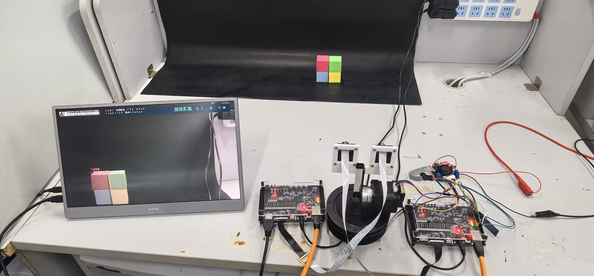
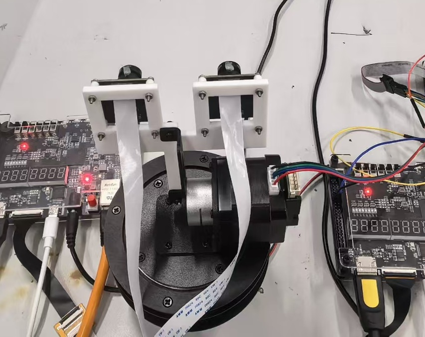
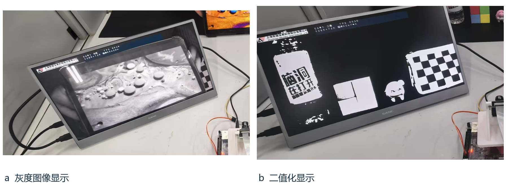
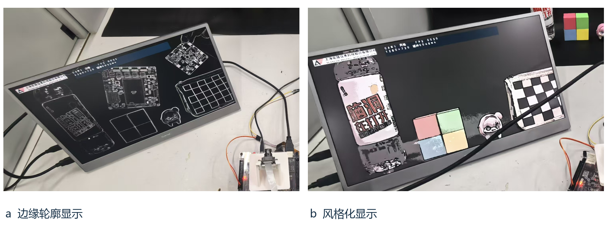
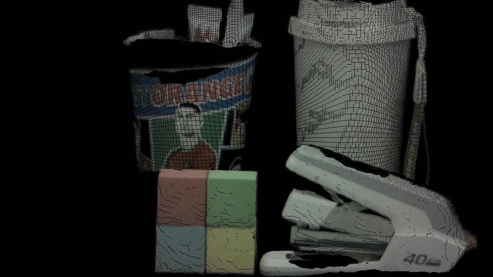
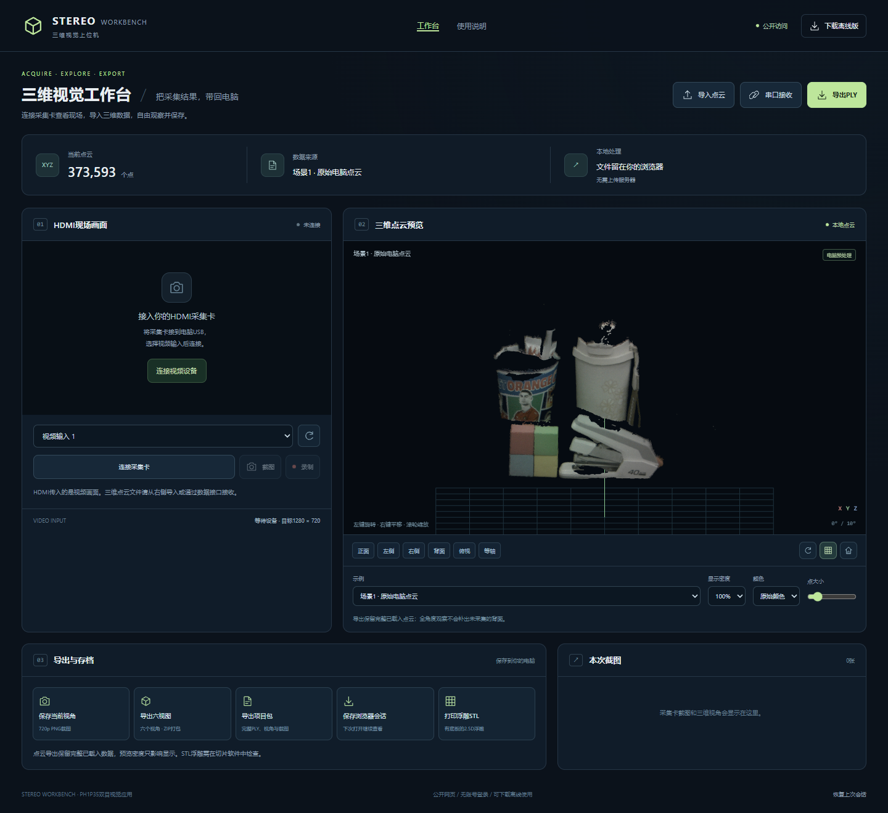
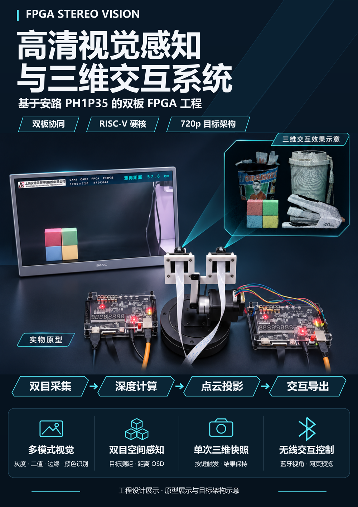

# 实物与界面图集

## 双板与双摄装配

## 单目处理

照片展示拍摄时原型与屏幕状态；不从一张图片推断跟踪速度、测量准确度或数据计算来源。

## 点云与上位机

上图是电脑离线生成的可视化，原始点云在examples/clouds中；它不是新FPGA实测。网页截图用于展示交互布局。

## 工程海报

海报主视觉经过AI辅助设计，720p标签指向目标架构。A3 PDF及300dpi图片随发布附件提供，适合上传GitHub Release。
